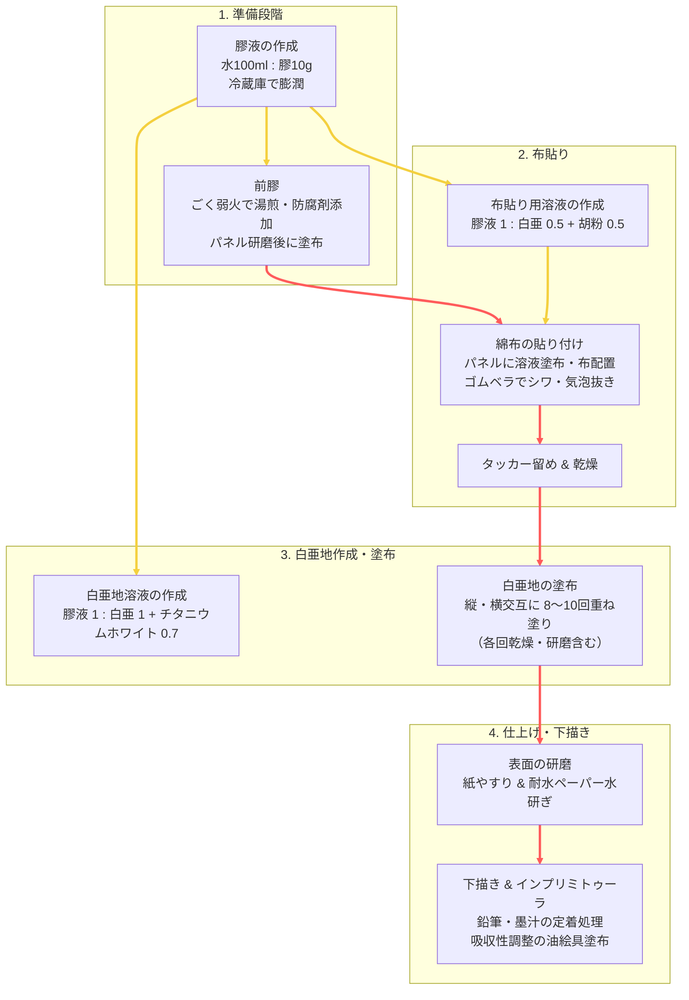

# 油彩用チョークグラウンド（白亜地）の作り方

白亜と兎膠（うさぎにかわ）を使った油彩用チョークグラウンドの材料と、パネルの下準備から布貼り・地塗り、下描き・インプリミトゥーラまでの手順を解説します。

## 全体制作フロー

黄色の矢印は材料の作成・受け渡し、赤色の矢印は作業の順序を示します。

---

## 必要な材料

- **白亜 [^1]**：重質炭酸カルシウム（ムードン）
- **チタニウムホワイト顔料 [^2]**：白色を強化
- **胡粉**（optional）：布貼り用にあれば使用
- **兎膠**：糊として利用
- **水**
- **シナベニヤパネル**
- **綿布 [^3]**
- **ガンタッカー**
- **ゴムベラ**

---

## 制作手順

### 1. 膠液の作成
1. 作業前日に膠液を作成する（水 100ml に対し、膠 10g 程度）。
2. 膠液を耐熱容器に入れて冷蔵庫で保管し、しっかりと膨潤させる。

### 2. 前膠
1. 膨潤させた膠液をごく弱火で湯煎し、防腐剤を添加する [^4]。
2. シナベニヤパネルを 300番〜400番の紙やすりで軽く研磨する。
3. 膠液を少量ボウルに移し、同量の水を添加する。
4. シナベニヤパネルに膠液を刷毛で塗布する（側面・裏面も同様）。
5. 1時間ほど乾燥させる。

### 3. 綿布の貼り付け
1. 膠液 1容量に対し、白亜 0.5容量 ＋ 胡粉 0.5容量を添加する [^5]。
2. ダマになりやすいのでよく混ぜる（指で溶け具合を確認）。
3. 綿布を水で濡らし、軽く絞っておく。
4. シナベニヤパネルに作成した溶液を刷毛で塗布する（側面・裏面も）。
5. 綿布をパネル上に置き、その上から溶液を塗布する。
6. 綿布を裏返し、裏面にも溶液を塗布する。
7. 中心から外側に向けて、ゴムベラや指を使いシワを伸ばす。
8. 気泡やシワが無いことを確認し、パネルを裏返す。
9. 綿布の端をハサミで適切にカットする。
10. 長辺の綿布から折り込み、ゴムベラでシワのないよう貼り付ける。
11. 短辺側も同様に処理する。
12. ガンタッカーで裏面をしっかりとホッチキス留めする。
13. 四辺を押しピンで固定してひっくり返す。
14. 表面に気泡があれば、ゴムベラで端へと優しく追い出す。
15. 最後に表面・側面に溶液を薄く塗布する。
16. パネルを十分に乾燥させ、1日目の作業を終了する。

### 4. 白亜地の作成
1. 膠液を湯煎して溶かす。
2. ボウルに膠液を適量入れる。
3. 膠液 1容量に対し、白亜 1容量 ＋ チタニウムホワイト 0.7容量を静かに振り入れる。
4. しばらく放置して十分に沈殿させてから、ゴムベラでダマがなくなるようゆっくりと混ぜる。
   - *Tip:* 気泡が出てくる場合は、混ぜるスピードが早すぎる可能性があるため、よく混ざるまで根気よく丁寧に混ぜる。

### 5. 白亜地の塗布
1. パネル表面にホコリが付着していれば綺麗に払っておく。
2. 300〜400番の紙やすりで軽く研磨しておく。
3. パネルに白亜を縦方向に塗布する（表面・側面ともに実施）。刷毛の毛抜けがないか要チェック。
4. 1時間乾燥させ、ホコリを払う。
5. 今度は白亜を横方向に塗布する。
6. **以降、縦・横の塗布・乾燥を 8〜10回程度繰り返し**、厚みと下地を整える。

### 6. 白亜地の研磨
1. 最終乾燥後、300番〜400番の紙やすりで全体を丁寧に研磨する。
2. 最後に耐水ペーパーで水研ぎを行い、画面を完全に平滑化する。

---

## 下描きとインプリミトゥーラ

### 下描き
- **鉛筆・墨汁**
  1. 鉛筆で下書きを行う。
  2. そのままだと黒鉛が定着しにくいため、描いたあとに上から刷り込むように定着させる。
  3. 軽く水を含ませた刷毛で撫でることで、溶けた白亜地となじみしっかりと定着する。
  4. 後述のインプリミトゥーラを暗色や濃い色で実施する場合は、墨汁で下描きしても良い。
- **油彩との相性に関する注意**
  - 白亜地に直接油彩を施すと、油分が過剰に吸収されて絵具本来の色調や艶が失われる。
  - 固着性も損なわれるため、必ず**インプリマトゥーラ**を施すようにする。
  - 白地をそのまま活かしたい場合は、画用液のみを薄く塗布する。

### インプリミトゥーラ
- 白亜地は吸収性が非常に強いため、その吸収性をコントロールし、絵具層の密着性を高めるために第一層として画用液を主とした絵具を塗布する。
- 絵具に少量のポピーオイル・多めのテレピンを溶き、刷毛で素早く画面に塗布する。
- *Caution:* 下描きが透けて見えなくなっても、ティッシュ等で強く拭き取ると白亜層まで削り取ってしまうため避けること。

---

## REFERENCES
- 画家 小木曽誠, 【白亜地の作り方】  
  https://www.youtube.com/watch?v=LBsTXt4YFzU
- OKUAKI STUDIO art channel, ART & MATERIALS // テンペラ画のための地塗り②【白亜地の作り方】  
  https://www.youtube.com/watch?v=f_IlkK1ag_w

---

[^1]: 画材店で販売されている下地用ムードンで良い。炭酸カルシウムは、軽質炭酸カルシウム（軽炭）と重質炭酸カルシウム（重炭）に分類される。軽炭は化学的に製造され、沈降性炭酸カルシウム、合成炭酸カルシウムとも呼ばれる。重炭は石灰石を物理的に粉砕、分級して製造される。重炭のほうが粒子形状が大きく、安価であり、下地作成に向いている。

[^2]: チタニウムホワイトにはルチル型とアナターゼ型がある。

    #### ルチル型チタニウムホワイト
    - 高い光沢・耐候性
    - 紫外線抵抗：黄変しづらい
    - 発色の良さ
    - 優れた被覆力
    - 安定性が高い
    - 画材用顔料では油性・水性両材料に適していると説明される

    #### アナターゼ型チタニウムホワイト
    - 透明度と輝度
    - 安価
    - 紫外線に対する触媒作用が強い（周囲の有機物を分解）…顔料を覆う有機物が分解され白い粉が浮く（チョーキング）
    - 画材用顔料では水性材料に適していると説明される

    #### 物性比較
    | 項目 | ルチル | アナターゼ |
    | :--- | :---: | :---: |
    | 結晶系 | 正方晶系 | 正方晶系 |
    | 密度 ($g/cm^3$) | 4.27 | 3.90 |
    | モース硬度 | 7.0〜7.5 | 5.5〜6.0 |
    | 融点 ($\degree C$) | 1,825 | ルチルに転移 |
    | 屈折率 $n_D$ | 2.72 | 2.52 |

    *出典：清野学 (1991). 酸化チタン－物性と応用技術. 技報堂出版, 東京.; 野坂芳雄，野坂篤子 (2004). 入門光触媒. 東京図書.*

[^3]: 下地の強度を向上させるため、織目の粗い布の方が適している。目の細かいものではコーマブロードでも作成はできたが、布が硬く扱いづらかった。シーチング生地や寒冷紗がよくおすすめされる。

[^4]: 膠液の湯煎には、哺乳瓶用湯煎器が便利である。60 $\degree C$ での温め、保温が可能である。  
    https://twitter.com/kikkawa1964/status/1793416554039697712

[^5]: 膠液は多少希釈しても良いが、布の張り付きが甘くなるので濃いぐらいでちょうど良い。