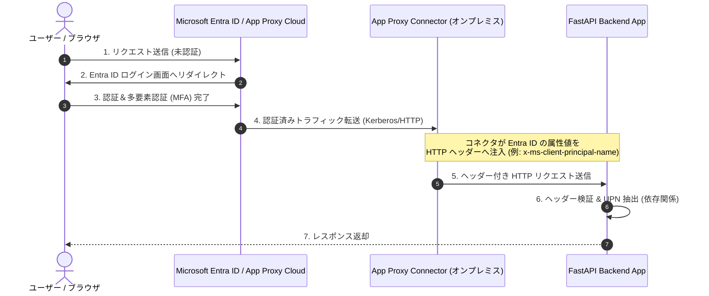

Microsoft Entra アプリ プロキシ (Application Proxy) を利用してオンプレミスや閉域網内の Web アプリケーションにシングルサインオン (SSO) を実現する際、認証されたユーザーの識別情報（UPN等）を HTTP リクエストヘッダー経由で受領・処理する手順と実装例についてまとめます。

---

## 1. 全体概要とシステム構成

Entra ID で事前認証を行ったクライアントからのアクセスは、クラウド上のアプリ プロキシ サービスおよびオンプレミス内に設置されたアプリ プロキシ コネクタを経由して、FastAPI アプリケーションへルーティングされます。

### 構成図 (Architecture)



---

## 2. ヘッダー仕様とMicrosoft属性マッピング

アプリ プロキシで「ヘッダー ベースのシングルサインオン (Header-based SSO)」を設定すると、Entra ID 上のユーザー属性が HTTP ヘッダーに属性値として挿入されます。

### 代表的なヘッダー属性

| ヘッダー名（デフォルト例） | マッピングする Entra ID 属性 | 説明 | 例 |
| :--- | :--- | :--- | :--- |
| `x-ms-client-principal-name` | `userPrincipalName` (UPN) | ユーザープリンシパル名 | `user@contoso.com` |
| `x-ms-client-principal-id` | `objectId` | ユーザーの Entra ID オブジェクト ID | `11111111-2222-3333-4444-555555555555` |
| `x-ms-client-display-name` | `displayName` | 表示名 | `山田 太郎` |
| `x-ms-client-mail` | `mail` | メールアドレス | `yamada@contoso.com` |

> **注意点:**
> * ヘッダー名（キー）は Azure ポータルの設定画面でカスタム指定・変換可能です。
> * アプリ プロキシを経由せずにバックエンドへ直接アクセスされた場合、ヘッダーの偽装 (Header Spoofing) のリスクが生じます。そのため、ネットワークセキュリティグループ (NSG) や Firewall で**コネクタからの IP アドレスのみ許可**するよう制御してください。

---

## 3. セットアップ手順 (Microsoft Entra アラカルト)

1. **Azure ポータル** (`portal.azure.com`) にログインします。
2. **Microsoft Entra ID** > **エンタープライズ アプリケーション** を開きます。
3. 新しいアプリケーションを作成、または既存の**アプリケーション プロキシ**アプリを選択します。
4. **シングル サインオン** 設定を開き、方式として **[ヘッダー ベース (Header-based)]** を選択します。
5. **ヘッダー フィールド** の設定で、FastAPI アプリに渡したい属性（UPN、メールアドレス等）および受け渡すヘッダー名を定義します。

---

## 4. FastAPI 実装コード (Cookbook)

FastAPI の `Header` および `Depends` (依存性注入) 機能を利用して、認証ヘッダーをエレガントかつ安全に抽出・検証するコードです。

```python
from typing import Optional
from fastapi import FastAPI, Header, HTTPException, status, Depends
from pydantic import BaseModel

app = FastAPI(
    title="App Proxy Authenticated API",
    version="1.0.0"
)

# -------------------------------------------------------------------
# Data Model
# -------------------------------------------------------------------
class UserContext(BaseModel):
    upn: str
    object_id: Optional[str] = None
    display_name: Optional[str] = None

# -------------------------------------------------------------------
# Dependency: アプリプロキシからのヘッダー抽出関数
# -------------------------------------------------------------------
async def get_current_user(
    # FastAPI はデフォルトでハイフンをアンダースコアに変換し、小文字化して解釈します
    # x-ms-client-principal-name -> x_ms_client_principal_name
    x_ms_client_principal_name: Optional[str] = Header(None, alias="x-ms-client-principal-name"),
    x_ms_client_principal_id: Optional[str] = Header(None, alias="x-ms-client-principal-id"),
    x_ms_client_display_name: Optional[str] = Header(None, alias="x-ms-client-display-name"),
) -> UserContext:
    """
    App Proxy から注入されたヘッダーを取得・検証する Dependency。
    ヘッダーが存在しない（直接アクセス等の）場合は 401 Unauthorized を返す。
    """
    if not x_ms_client_principal_name:
        raise HTTPException(
            status_code=status.HTTP_401_UNAUTHORIZED,
            detail="App Proxy authentication header is missing. Direct access is restricted.",
        )

    return UserContext(
        upn=x_ms_client_principal_name,
        object_id=x_ms_client_principal_id,
        display_name=x_ms_client_display_name,
    )

# -------------------------------------------------------------------
# Endpoints
# -------------------------------------------------------------------
@app.get("/")
def read_root():
    return {"message": "Public Endpoint"}

@app.get("/api/me", response_model=UserContext)
def get_user_profile(current_user: UserContext = Depends(get_current_user)):
    """
    認証済みユーザーの情報を返すエンドポイント
    """
    return current_user

@app.get("/api/secure-data")
def get_secure_data(current_user: UserContext = Depends(get_current_user)):
    """
    UPN に基づく処理を行うセキュリティ保護されたエンドポイント
    """
    return {
        "status": "success",
        "user_email": current_user.upn,
        "content": f"Hello, {current_user.display_name or current_user.upn}! This is protected data."
    }
```

---

## 5. テスト・検証手順

### ローカルでの検証（cURL によるヘッダー偽装テスト）

開発段階では、`curl` コマンドを使用してアプリ プロキシが送出するヘッダーを再現できます。

```bash
# 正常系テスト（ヘッダー付与）
curl -X GET "http://localhost:8000/api/me" \
     -H "x-ms-client-principal-name: taro.yamada@contoso.com" \
     -H "x-ms-client-principal-id: 11111111-2222-3333-4444-555555555555" \
     -H "x-ms-client-display-name: Yamada Taro"

# 異常系テスト（直接アクセス・ヘッダーなし） -> 401 エラーになることを確認
curl -X GET "http://localhost:8000/api/me"
```

---

## 6. セキュリティと運用上の注意点

1. **直接アクセスの禁止 (IP 制限)**
   * バックエンド サーバー（FastAPI）がインターネットから直接アクセスできる状態だと、攻撃者が自由に `x-ms-client-principal-name` ヘッダーを捏造してリクエストを送信できてしまいます。
   * **対策:** ネットワークまたは Web サーバー (Nginx, IIS 等) レベルで、App Proxy Connector が存在する IP アドレスからの通信のみを受け入れるよう制御してください。
2. **文字コードに関する注意**
   * `displayName` など日本語が含まれる属性をヘッダー経由で受信する場合、文字化け（URLエンコードや ISO-8859-1 / UTF-8 の変換問題）が発生することがあります。必要に応じて `urllib.parse.unquote` などを用いて受け側でデコード処理を実装してください。

---

## 7. 参考ドキュメント (公式リンク)

* [Microsoft Learn: Microsoft Entra アプリ プロキシを使用したヘッダー ベースの SSO](https://learn.microsoft.com/ja-jp/entra/identity/app-proxy/application-proxy-configure-single-sign-on-with-headers)
* [FastAPI Documentation: Header Parameters](https://fastapi.tiangolo.com/tutorial/header-params/)
```
