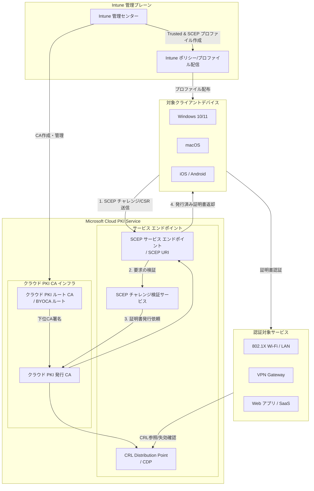
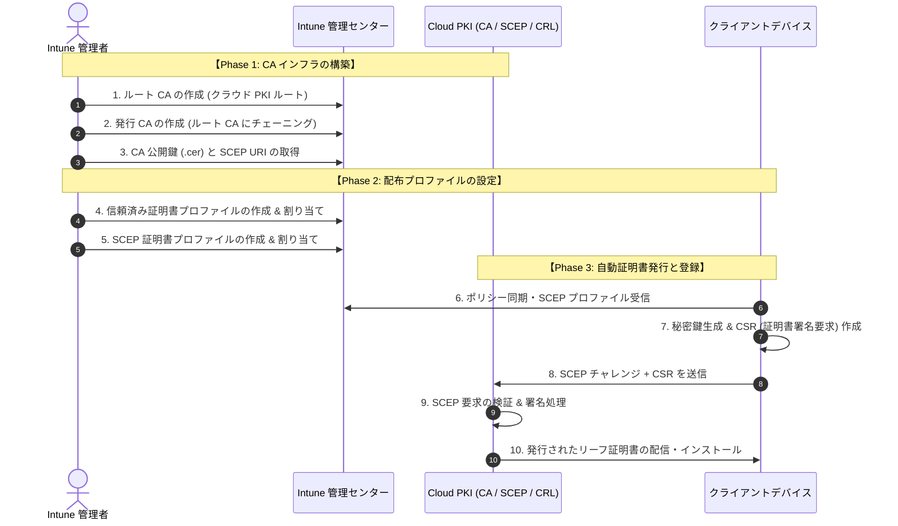
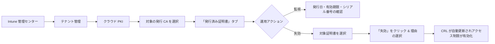

本手順書は、Microsoft Intune の **Cloud PKI（Microsoft Cloud PKI for Microsoft Intune）** を利用して、オンプレミス PKI インフラ（ADCS / NDES 等）を一切使用せずにクラウド完結で証明書を発行・配布するための完全ガイドです。

## 1. アーキテクチャと全体フロー

Microsoft Cloud PKI は、オンプレミスの CA サーバー、NDES、Connector ソフトウェア等を介さず、Microsoft Cloud 上で認証局（CA）機能および SCEP サービスを統合提供します。

### 1.1 Cloud PKI コンポーネント構成図（アーキテクチャ）

### 1.2 全体処理シーケンス

## 2. 前提条件とロール権限

### 2.1 ライセンスおよびデバイス要件

* **ライセンス**: Microsoft Intune Plan 1 に加え、**Microsoft Intune Suite** または **Microsoft Cloud PKI アドオン** ライセンスが割り当てられていること。

* **対象 OS**: Windows 10/11、macOS、iOS / iPadOS、Android (Fully Managed / Work Profile)

* **デバイス状態**: Microsoft Intune に正常に MDM 登録（Enrollment）されていること。

### 2.2 必要な RBAC 権限

Intune 管理センターでの設定を行う管理者は、以下のアクセス許可（ロール）が必要です：

* **Cloud PKI 権限**: `CA の作成 (Create CA)`, `CA の読み取り (Read CA)`, `リーフ証明書の失効 (Revoke Leaf Certificates)`

* **デバイス構成権限**: `デバイス構成プロファイルの作成/割り当て (Device Configurations)`

## 3. ステップバイステップ構築・配布手順

### ステップ 1: クラウド PKI ルート CA の作成

1. [**Microsoft Intune 管理センター**](https://intune.microsoft.com/) にサインインします。

2. 左側メニューから **\[テナント管理\]** を開き、**\[クラウド PKI\]** を選択します。

3. **\[作成\]** ボタンをクリックします。

4. **\[基本\]** タブ:

   * **名前**: ルート CA の名称を入力（例: `Contoso-CloudPKI-Root-CA`）

   * **説明**: 目的を入力（任意）

   * **\[次へ\]** を選択します。

5. **\[構成設定\]** タブ:

   * **CA タイプ**: `クラウド PKI ルート CA` を選択

   * **有効期間**: `25 年`（選択肢: 5, 10, 15, 20, 25 年から選択）

   * **拡張キー使用法 (EKU)**: `クライアント認証`（必要に応じて `サーバー認証` も選択）

   * **サブジェクト属性**:

     * **共通名 (CN)**: 例: `Contoso Root Certification Authority`

     * **組織 (O)**: 例: `Contoso Ltd`

     * **国/地域 (C)**: `JP`（※2文字の国コード）

   * **暗号化 (キーサイズ)**: `RSA-2048`（要件に応じて RSA-3072 / RSA-4096 も可能）

   * **\[次へ\]** を選択します。

6. **\[スコープ タグ\]**: 必要に応じてタグを設定し **\[次へ\]** を進めます。

7. **\[確認と作成\]**: 設定内容を確認し、**\[作成\]** を選択します。

### ステップ 2: クラウド PKI 発行 CA (Issuing CA) の作成

1. **\[テナント管理\]** > **\[クラウド PKI\]** 画面で再度 **\[作成\]** をクリックします。

2. **\[基本\]** タブ:

   * **名前**: 発行 CA の名称を入力（例: `Contoso-CloudPKI-Issuing-CA`）

   * **\[次へ\]** を選択します。

3. **\[構成設定\]** タブ:

   * **CA タイプ**: `クラウド PKI 発行 CA` を選択

   * **ルート CA ソース**: `Intune` を選択

   * **ルート CA**: ステップ 1 で作成した `Contoso-CloudPKI-Root-CA` を選択

   * **有効期間**: `4 年`（選択肢: 2, 4, 6, 8, 10 年。※ルート CA の残効期間より短く設定）

   * **拡張キー使用法 (EKU)**: `クライアント認証`

   * **サブジェクト属性**:

     * **共通名 (CN)**: 例: `Contoso Issuing Certification Authority`

     * **組織 (O)**: 例: `Contoso Ltd`

   * **暗号化 (キーサイズ)**: `RSA-2048`

   * **\[次へ\]** を選択します。

4. **\[スコープ タグ\]** を設定し、**\[確認と作成\]** 画面で **\[作成\]** を選択します。

> ⚠️ **重要: 接続情報の取得**
> 作成完了後、CA 一覧から作成した **発行 CA** を選択し、**\[プロパティ\]** を開きます。
> 次のステップで使用するため、**\[SCEP URI\]** の文字列をコピーし、ルート CA および発行 CA の **\[証明書のダウンロード (.cer)\]** を行って公開鍵を取得しておきます。

### ステップ 3: 信頼済み証明書 (Trusted Certificate) プロファイルの作成と配備

デバイスが Cloud PKI のルート CA および発行 CA を信頼するためのプロファイルを作成します。

*(※ルート CA 用と発行 CA 用で合計 2 個のプロファイルを作成します)*

1. **\[デバイス\]** > **\[管理デバイス\]** > **\[構成\]**（または **\[デバイス\]** > OS別メニュー > **\[構成プロファイル\]**）を開きます。

2. **\[作成\]** > **\[新しいポリシー\]** を選択します。

3. **プロファイル設定**:

   * **プラットフォーム**: 対象 OS（例: `Windows 10 以降`）

   * **プロファイルの種類**: `テンプレート` > `信頼済み証明書` を選択して **\[作成\]**。

4. **\[基本\]**: 名前を入力（例: `Trusted Cert - Cloud PKI Root CA`）して **\[次へ\]**。

5. **\[構成設定\]**:

   * **証明書ファイル**: ステップ 2 でダウンロードした **ルート CA の .cer ファイル** をアップロード。

   * **宛先ストア**: `コンピューター証明書ストア - ルート`

6. **\[割り当て\]**: 配布対象となる **ユーザーグループ** または **デバイスグループ** を選択して **\[次へ\]**。

7. **\[確認と作成\]** で **\[作成\]** を実行します。

*※同様の手順で、ステップ 2 で取得した「発行 CA の .cer ファイル」を用いた信頼済み証明書プロファイル（宛先ストア: コンピューター証明書ストア - 中間）も作成し、同一グループに割り当てます。*

### ステップ 4: SCEP 証明書プロファイルの作成と配備

個々のデバイスにクライアント証明書を自動発行させるための SCEP プロファイルを構成します。

1. **\[デバイス\]** > **\[管理デバイス\]** > **\[構成\]** を開きます。

2. **\[作成\]** > **\[新しいポリシー\]** を選択します。

   * **プラットフォーム**: 対象 OS（例: `Windows 10 以降`）

   * **プロファイルの種類**: `テンプレート` > `SCEP 証明書` を選択して **\[作成\]**。

3. **\[基本\]**: 名前を入力（例: `SCEP Cert Profile - Client Auth`）して **\[次へ\]**。

4. **\[構成設定\]**:

   * **証明書の種類**: `ユーザー`（またはデバイス単位の場合は `デバイス`）

   * **サブジェクト名の形式**: `CN={{UserPrincipalName}}` または `CN={{DeviceName}}`

   * **サブジェクト代替名 (SAN)**:

     * **タイプ**: `ユーザープリンシパル名 (UPN)`

     * **値**: `{{UserPrincipalName}}`

   * **証明書の有効期間**: `1 年`

   * **キー格納プロバイダー (KSP)**: `TPM が存在する場合は TPM KSP を使用、それ以外はソフトウェア KSP`

   * **キーサイズ**: `2048`

   * **ハッシュ アルゴリズム**: `SHA-256`

   * **ルート証明書**: ステップ 3 で作成した「発行 CA 用の信頼済み証明書プロファイル」を選択

   * **拡張キー使用法 (EKU)**: `クライアント認証`

   * **SCEP サーバーの URL**: ステップ 2 で確認した **\[発行 CA の SCEP URI\]** を貼り付け

5. **\[割り当て\]**: 配布対象のグループを選択して **\[次へ\]**。

6. **\[確認と作成\]** で **\[作成\]** を選択します。

## 4. 証明書の管理・監視・失効（Revocation）

発行された証明書のステータス確認および緊急時の失効手順です。

### 4.1 発行状況の確認

* **\[テナント管理\]** > **\[クラウド PKI\]** > 対象の CA を選択 > **\[概要\]** ダッシュボードから、現在アクティブな証明書数や失効数を確認できます。

### 4.2 証明書の失効手順

1. **\[テナント管理\]** > **\[クラウド PKI\]** を開き、対象の **発行 CA** をクリックします。

2. **\[発行済み証明書\]**（Leaf Certificates）タブを開きます。

3. 失効させたい証明書（デバイス名や UPN で検索可能）を選択します。

4. 画面上部の **\[失効\]** ボタンをクリックします。

5. 失効の理由（例: `KeyCompromise`, `CessationOfOperation` 等）を選択し、実行します。

6. クラウド PKI の CRL (証明書失効リスト) が即座に更新され、対象証明書による認証が拒否されるようになります。

## 5. 参考資料

* [Microsoft Cloud PKI for Microsoft Intune の概要 - Microsoft Learn](https://learn.microsoft.com/ja-jp/intune/cloud-pki/)

* [Microsoft Cloud PKI 証明書プロファイルの構成 - Microsoft Learn](https://learn.microsoft.com/ja-jp/intune/protect/certificates-scep-configure)

本手順書は、Microsoft Intune の **Cloud PKI（Microsoft Cloud PKI for Microsoft Intune）** を利用して、オンプレミス PKI インフラ（ADCS / NDES 等）を一切使用せずにクラウド完結で証明書を発行・配布するための完全ガイドです。

---

## 1. アーキテクチャと全体フロー

Cloud PKI では、ルート CA・発行 CA・SCEP サービス・CRL（証明書失効リスト）発行機能がすべて Microsoft Cloud 上で提供されます。

### 1.1 全体処理シーケンス

---

## 2. 前提条件とロール権限

### 2.1 ライセンスおよびデバイス要件
- **ライセンス**: Microsoft Intune Plan 1 に加え、**Microsoft Intune Suite** または **Microsoft Cloud PKI アドオン** ライセンスが割り当てられていること。
- **対象 OS**: Windows 10/11、macOS、iOS / iPadOS、Android (Fully Managed / Work Profile)
- **デバイス状態**: Microsoft Intune に正常に MDM 登録（Enrollment）されていること。

### 2.2 必要な RBAC 権限
Intune 管理センターでの設定を行う管理者は、以下のアクセス許可（ロール）が必要です：
- **Cloud PKI 権限**: `CA の作成 (Create CA)`, `CA の読み取り (Read CA)`, `リーフ証明書の失効 (Revoke Leaf Certificates)`
- **デバイス構成権限**: `デバイス構成プロファイルの作成/割り当て (Device Configurations)`

---

## 3. ステップバイステップ構築・配布手順

### ステップ 1: クラウド PKI ルート CA の作成

1. **[Microsoft Intune 管理センター](https://intune.microsoft.com/)** にサインインします。
2. 左側メニューから **[テナント管理]** を開き、**[クラウド PKI]** を選択します。
3. **[作成]** ボタンをクリックします。
4. **[基本]** タブ:
   - **名前**: ルート CA の名称を入力（例: `Contoso-CloudPKI-Root-CA`）
   - **説明**: 目的を入力（任意）
   - **[次へ]** を選択します。
5. **[構成設定]** タブ:
   - **CA タイプ**: `クラウド PKI ルート CA` を選択
   - **有効期間**: `25 年`（選択肢: 5, 10, 15, 20, 25 年から選択）
   - **拡張キー使用法 (EKU)**: `クライアント認証`（必要に応じて `サーバー認証` も選択）
   - **サブジェクト属性**:
     - **共通名 (CN)**: 例: `Contoso Root Certification Authority`
     - **組織 (O)**: 例: `Contoso Ltd`
     - **国/地域 (C)**: `JP`（※2文字の国コード）
   - **暗号化 (キーサイズ)**: `RSA-2048`（要件に応じて RSA-3072 / RSA-4096 も可能）
   - **[次へ]** を選択します。
6. **[スコープ タグ]**: 必要に応じてタグを設定し **[次へ]** を進めます。
7. **[確認と作成]**: 設定内容を確認し、**[作成]** を選択します。

---

### ステップ 2: クラウド PKI 発行 CA (Issuing CA) の作成

1. **[テナント管理]** > **[クラウド PKI]** 画面で再度 **[作成]** をクリックします。
2. **[基本]** タブ:
   - **名前**: 発行 CA の名称を入力（例: `Contoso-CloudPKI-Issuing-CA`）
   - **[次へ]** を選択します。
3. **[構成設定]** タブ:
   - **CA タイプ**: `クラウド PKI 発行 CA` を選択
   - **ルート CA ソース**: `Intune` を選択
   - **ルート CA**: ステップ 1 で作成した `Contoso-CloudPKI-Root-CA` を選択
   - **有効期間**: `4 年`（選択肢: 2, 4, 6, 8, 10 年。※ルート CA の残効期間より短く設定）
   - **拡張キー使用法 (EKU)**: `クライアント認証`
   - **サブジェクト属性**:
     - **共通名 (CN)**: 例: `Contoso Issuing Certification Authority`
     - **組織 (O)**: 例: `Contoso Ltd`
   - **暗号化 (キーサイズ)**: `RSA-2048`
   - **[次へ]** を選択します。
4. **[スコープ タグ]** を設定し、**[確認と作成]** 画面で **[作成]** を選択します。

> ⚠️ **重要: 接続情報の取得**
> 作成完了後、CA 一覧から作成した **発行 CA** を選択し、**[プロパティ]** を開きます。
> 次のステップで使用するため、**[SCEP URI]** の文字列をコピーし、ルート CA および発行 CA の **[証明書のダウンロード (.cer)]** を行って公開鍵を取得しておきます。

---

### ステップ 3: 信頼済み証明書 (Trusted Certificate) プロファイルの作成と配備

デバイスが Cloud PKI のルート CA および発行 CA を信頼するためのプロファイルを作成します。
*(※ルート CA 用と発行 CA 用で合計 2 個のプロファイルを作成します)*

1. **[デバイス]** > **[管理デバイス]** > **[構成]**（または **[デバイス]** > OS別メニュー > **[構成プロファイル]**）を開きます。
2. **[作成]** > **[新しいポリシー]** を選択します。
3. **プロファイル設定**:
   - **プラットフォーム**: 対象 OS（例: `Windows 10 以降`）
   - **プロファイルの種類**: `テンプレート` > `信頼済み証明書` を選択して **[作成]**。
4. **[基本]**: 名前を入力（例: `Trusted Cert - Cloud PKI Root CA`）して **[次へ]**。
5. **[構成設定]**:
   - **証明書ファイル**: ステップ 2 でダウンロードした **ルート CA の .cer ファイル** をアップロード。
   - **宛先ストア**: `コンピューター証明書ストア - ルート`
6. **[割り当て]**: 配布対象となる **ユーザーグループ** または **デバイスグループ** を選択して **[次へ]**。
7. **[確認と作成]** で **[作成]** を実行します。

*※同様の手順で、ステップ 2 で取得した「発行 CA の .cer ファイル」を用いた信頼済み証明書プロファイル（宛先ストア: コンピューター証明書ストア - 中間）も作成し、同一グループに割り当てます。*

---

### ステップ 4: SCEP 証明書プロファイルの作成と配備

個々のデバイスにクライアント証明書を自動発行させるための SCEP プロファイルを構成します。

1. **[デバイス]** > **[管理デバイス]** > **[構成]** を開きます。
2. **[作成]** > **[新しいポリシー]** を選択します。
   - **プラットフォーム**: 対象 OS（例: `Windows 10 以降`）
   - **プロファイルの種類**: `テンプレート` > `SCEP 証明書` を選択して **[作成]**。
3. **[基本]**: 名前を入力（例: `SCEP Cert Profile - Client Auth`）して **[次へ]**。
4. **[構成設定]**:
   - **証明書の種類**: `ユーザー`（またはデバイス単位の場合は `デバイス`）
   - **サブジェクト名の形式**: `CN={{UserPrincipalName}}` または `CN={{DeviceName}}`
   - **サブジェクト代替名 (SAN)**:
     - **タイプ**: `ユーザープリンシパル名 (UPN)`
     - **値**: `{{UserPrincipalName}}`
   - **証明書の有効期間**: `1 年`
   - **キー格納プロバイダー (KSP)**: `TPM が存在する場合は TPM KSP を使用、それ以外はソフトウェア KSP`
   - **キーサイズ**: `2048`
   - **ハッシュ アルゴリズム**: `SHA-256`
   - **ルート証明書**: ステップ 3 で作成した「発行 CA 用の信頼済み証明書プロファイル」を選択
   - **拡張キー使用法 (EKU)**: `クライアント認証`
   - **SCEP サーバーの URL**: ステップ 2 で確認した **[発行 CA の SCEP URI]** を貼り付け
5. **[割り当て]**: 配布対象のグループを選択して **[次へ]**。
6. **[確認と作成]** で **[作成]** を選択します。

---

## 4. 証明書の管理・監視・失効（Revocation）

発行された証明書のステータス確認および緊急時の失効手順です。

### 4.1 発行状況の確認
- **[テナント管理]** > **[クラウド PKI]** > 対象の CA を選択 > **[概要]** ダッシュボードから、現在アクティブな証明書数や失効数を確認できます。

### 4.2 証明書の失効手順
1. **[テナント管理]** > **[クラウド PKI]** を開き、対象の **発行 CA** をクリックします。
2. **[発行済み証明書]**（Leaf Certificates）タブを開きます。
3. 失効させたい証明書（デバイス名や UPN で検索可能）を選択します。
4. 画面上部の **[失効]** ボタンをクリックします。
5. 失効の理由（例: `KeyCompromise`, `CessationOfOperation` 等）を選択し、実行します。
6. クラウド PKI の CRL (証明書失効リスト) が即座に更新され、対象証明書による認証が拒否されるようになります。

---

## 5. 参考資料
* [Microsoft Cloud PKI for Microsoft Intune の概要 - Microsoft Learn](https://learn.microsoft.com/ja-jp/intune/cloud-pki/)
* [Microsoft Cloud PKI 証明書プロファイルの構成 - Microsoft Learn](https://learn.microsoft.com/ja-jp/intune/protect/certificates-scep-configure)