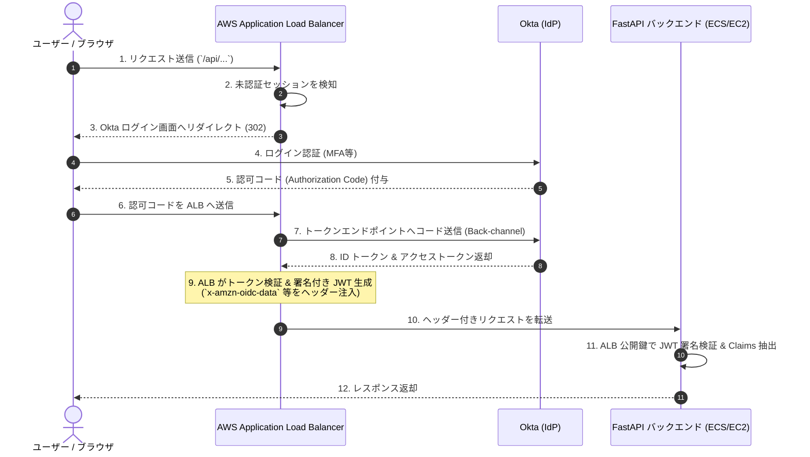

本ドキュメントでは、IdP である Okta で認証を行い、AWS 上の Application Load Balancer (ALB) を通じて Python (FastAPI) バックエンドへユーザー属性（UPN、Email、Groupなど）を HTTP ヘッダーとして安全に受け渡す手順と実装についてまとめます。

---

## 1. アーキテクチャ選定：ALB 認証 vs Cognito 経由

AWS 上で Okta 認証を統合する場合、**「ALB OIDC 認証機能」** を直接利用するパターンと **「Amazon Cognito を経由する」** パターンの2通りが一般的です。

### 比較検討表

| 項目 | ALB 直接連携 (推奨) | ALB + Amazon Cognito 経由 |
| :--- | :--- | :--- |
| **構成のシンプルさ** | **高** (ALBとOktaを直接接続) | **中** (Cognito ユーザープール/IdP設定が必要) |
| **コスト** | **低** (ALBの標準機能。追加コストなし) | **中〜高** (CognitoのMAU課金が発生) |
| **セキュリティ** | **高** (ALBがJWTを検証・署名してバックエンドへ渡す) | **高** (同等) |
| **ユースケース** | **SAML/OIDC対応の既存IdP (Okta) を一元利用したい場合** | アプリ側で柔軟なユーザー管理・UIカスタムが必要な場合 |

### **推奨：ALB 直接連携 (ALB OIDC Authentication)**
Okta をプライマリ IdP として使用している組織では、**ALB の OIDC 認証機能を直接使用する構成**を推奨します。
* **理由 1 (コスト):** Cognito の二重管理費用が発生せず、ALB の基本料金のみで運用できます。
* **理由 2 (運用保守):** ユーザー管理を一元的に Okta へ集約でき、AWS 側のユーザープール管理を簡略化できます。
* **理由 3 (セキュリティ):** ALB が Okta との OIDC フロー（トークン交換・検証）を代行し、バックエンドには検証済みの JWT ヘッダー（`x-amzn-oidc-data`）を送信するため、非常に安全です。

---

## 2. 全体概要とシステム構成

### シーケンス図



---

## 3. 各種設定手順

### 3.1. Okta 側の設定手順

1. **Okta Admin Console** にログインします。
2. **Applications** > **Applications** > **Create App Integration** を選択します。
3. **Sign-in method** で `OIDC - OpenID Connect` を選択し、**Application type** で `Web Application` を選択して **Next** をクリックします。
4. 設定項目を以下のように構成します：
   * **App integration name**: 例 `AWS-ALB-Authentication`
   * **Grant type**: `Authorization Code` をチェック。
   * **Sign-in redirect URIs**: `https://<あなたのALBのドメイン名>/oauth2/idpresponse`
     *(※ ALB の OIDC 認証機能専用の固定パスです)*
   * **Assignments**: 適切なユーザーまたはグループを割り当てます。
5. 保存後、発行された **Client ID** および **Client Secret** を控え、**Okta Domain** (`https://your-subdomain.okta.com`) を確認します。

---

### 3.2. AWS ALB 側の設定手順

1. **AWS Management Console** > **EC2** > **ロードバランサー (ALB)** を開きます。
2. 対象の HTTPS リスナー（443 番ポート）を選択し、**ルールの編集**を行います。
3. ルールの「アクション」に **認証 (Authenticate)** を追加します：
   * **Authenticate**: `OIDC` を選択。
   * **Issuer (発行体)**: `https://<Oktaドメイン>/oauth2/default` (またはカスタムドメイン)
   * **Authorization endpoint**: `https://<Oktaドメイン>/oauth2/v1/authorize`
   * **Token endpoint**: `https://<Oktaドメイン>/oauth2/v1/token`
   * **User info endpoint**: `https://<Oktaドメイン>/oauth2/v1/userinfo`
   * **Client ID**: Okta で取得した Client ID
   * **Client Secret**: Okta で取得した Client Secret
   * **Scope**: `openid profile email groups`
4. 順序として「認証」アクションの後に **転送先 (Forward to)**（FastAPI が動作するターゲットグループ）を指定します。

---

## 4. FastAPI 実装コード (Cookbook)

ALB はバックエンドに以下のヘッダーを送信します。
* `x-amzn-oidc-accesstoken`: Okta から取得したアクセストークン
* `x-amzn-oidc-identity`: ユーザー識別子 (`sub`)
* `x-amzn-oidc-data`: ALB によって署名された **JWT (JSON Web Token)**（ユーザー属性が含まれる）

> **重要 (セキュリティ・ベストプラクティス):**
> 攻撃者が偽造ヘッダーをバックエンドに直接送信するのを防ぐため、 Fast API 側で `x-amzn-oidc-data` の **JWT 署名を AWS の公開鍵を用いて検証** します。

### サンプルコード

```python
import jwt
import requests
from typing import Optional, List
from fastapi import FastAPI, Header, HTTPException, status, Depends
from pydantic import BaseModel, EmailStr

app = FastAPI(
    title="Okta & AWS ALB Authenticated API",
    version="1.0.0"
)

# 公開鍵キャッシュ用の辞書
JWKS_CACHE = {}

class UserProfile(BaseModel):
    sub: str
    email: Optional[EmailStr] = None
    username: Optional[str] = None
    groups: List[str] = []

def get_alb_public_key(key_id: str, region: str) -> str:
    """
    AWS ALB の公開鍵を取得する (キャッシュ機能付き)
    """
    if key_id in JWKS_CACHE:
        return JWKS_CACHE[key_id]

    # ALB 公開鍵のダウンロード URL
    url = f"https://public-keys.auth.elb.{region}.amazonaws.com/{key_id}"
    response = requests.get(url)
    if response.status_code != 200:
        raise HTTPException(
            status_code=status.HTTP_500_INTERNAL_SERVER_ERROR,
            detail="Failed to retrieve ALB public key."
        )

    public_key = response.text
    JWKS_CACHE[key_id] = public_key
    return public_key


async def verify_alb_jwt(
    x_amzn_oidc_data: Optional[str] = Header(None, alias="x-amzn-oidc-data"),
    x_amzn_oidc_identity: Optional[str] = Header(None, alias="x-amzn-oidc-identity")
) -> UserProfile:
    """
    ALB から送られた JWT の署名を検証し、ユーザー情報をデコードする Dependency
    """
    if not x_amzn_oidc_data:
        raise HTTPException(
            status_code=status.HTTP_401_UNAUTHORIZED,
            detail="Missing ALB OIDC header. Direct access is not allowed."
        )

    try:
        # 1. JWT ヘッダーから Key ID (kid) と アルゴリズムを抽出
        jwt_headers = jwt.get_unverified_header(x_amzn_oidc_data)
        key_id = jwt_headers.get("kid")
        alg = jwt_headers.get("alg", "ES256")

        # 例: Key ID から リージョンを推測、または環境変数から指定 (例: ap-northeast-1)
        # ALB の Key ID 形式: arn:aws:elasticloadbalancing:region:account-id:loadbalancer/app/...
        region = key_id.split(":")[3] if ":" in key_id else "ap-northeast-1"

        # 2. AWS から公開鍵を取得
        public_key = get_alb_public_key(key_id, region)

        # 3. JWT 署名の検証とデコード
        payload = jwt.decode(
            x_amzn_oidc_data,
            public_key,
            algorithms=[alg],
            options={"verify_commit": True}
        )

        # 4. UserProfile オブジェクトの構築
        return UserProfile(
            sub=payload.get("sub", x_amzn_oidc_identity),
            email=payload.get("email"),
            username=payload.get("preferred_username") or payload.get("email"),
            groups=payload.get("groups", [])
        )

    except jwt.PyJWTError as e:
        raise HTTPException(
            status_code=status.HTTP_401_UNAUTHORIZED,
            detail=f"Invalid OIDC Token: {str(e)}"
        )


# -------------------------------------------------------------------
# Endpoints
# -------------------------------------------------------------------
@app.get("/health")
def health_check():
    return {"status": "ok"}

@app.get("/api/me", response_model=UserProfile)
def read_current_user(user: UserProfile = Depends(verify_alb_jwt)):
    """
    認証済みユーザーのプロファイル情報を返却するエンドポイント
    """
    return user

@app.get("/api/admin-only")
def read_admin_data(user: UserProfile = Depends(verify_alb_jwt)):
    """
    Oktaの所属グループ（例: Admin）による認可チェック例
    """
    if "Admin" not in user.groups:
        raise HTTPException(
            status_code=status.HTTP_403_FORBIDDEN,
            detail="Access forbidden: Admin group membership required."
        )
    return {"message": f"Welcome Admin {user.username}!"}
```

---

## 5. セキュリティ・ベストプラクティス

1. **セキュリティグループによる直接アクセスの遮断**
   FastAPI が動作するインフラ (ECS サービス、EC2 など) のセキュリティグループは、**ALB からのトラフィック（HTTP/HTTPS）のみを許可** するように設定してください。インターネットからの直接通信を遮断することで、ヘッダー偽装のリスクを根本から排除します。

2. **`x-amzn-oidc-data` の署名検証の徹底**
   単に `x-amzn-oidc-identity` などのプレーンテキストヘッダーを信頼するのではなく、必ず `x-amzn-oidc-data` の JWT を AWS が提供する EC 鍵 (ES256) で検証してください。

3. **公開鍵のキャッシュ**
   AWS 公開鍵エンドポイントへの頻繁なリクエストによる遅延や制限を防ぐため、アプリ側で `kid` に基づいて公開鍵をメモリ内にキャッシュしてください。

---

## 6. 参考ドキュメント (公式)

* [AWS Official: Application Load Balancer を使用してユーザーを認証する](https://docs.aws.amazon.com/ja_jp/elasticloadbalancing/latest/application/listener-authenticate-users.html)
* [Okta Developer: Configure OpenID Connect Web Application](https://developer.okta.com/docs/guides/sign-into-web-app-redirect/openidconnect/main/)
* [PyJWT Documentation](https://pyjwt.readthedocs.io/en/stable/)
```
